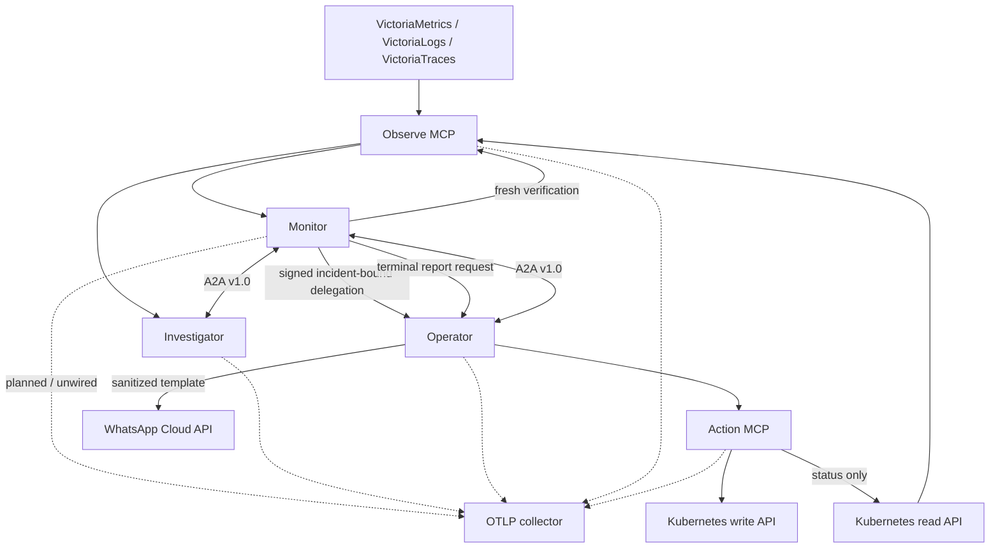

# Architecture

## Purpose

AegisSRE separates incident detection, diagnosis, authorization, and execution so that no reasoning component has ambient infrastructure authority. The system is autonomous inside explicit policy boundaries; it is not autonomous in defining those boundaries.

This document describes the implemented pre-release architecture and its invariants. The executable composes all five services. Deterministic in-process control-plane E2E tests cross real MCP, A2A, and notification HTTP boundaries, covering a successful signed live fixture recovery and an outside-authority escalation with zero action calls; a separate integration test covers safe dry-run delegation. These tests are not separate-process Compose or live-k3s E2E. Production identity, durable shared state, OTLP export, and live-cluster validation are still outside the implemented assurance boundary.

## Context



The dashed edges show the intended AegisSRE observability path, not current behavior. The binary exposes Prometheus process/build metrics at `/metrics`, but it does not initialize an OTLP exporter. Checked-in runtime configuration supplies neither OTEL settings nor collector egress. A future exporter must never carry private keys, bearer tokens, raw authorization headers, or unredacted sensitive log content.

## Agent responsibilities

### Monitor

Monitor owns the incident state machine and policy decision, not diagnosis details or Kubernetes writes.

1. Scan immediately at startup and then on the configured interval using bounded, server-owned metric, structured-log, and trace templates.
2. Require the configured number of consecutive qualifying scans for the same rule/namespace/Deployment fingerprint; duplicate rows in one scan count once.
3. Create an incident identifier and ask Investigator for a diagnosis over A2A.
4. Refresh the workload snapshot. Resolve as `resolved_without_action` if it has already recovered; otherwise bind the current resource version and replica count as preconditions.
5. Validate the proposed action and produce a short-lived Ed25519-signed delegation for that exact action.
6. Ask Operator to execute it.
7. After a successful live receipt, take one fresh workload snapshot. Resolve immediately if it is available; otherwise retain the same remediating incident as `verification_pending` and retry only that observation at the start of each scheduled scan.
8. Block redelegation while verification is pending. Resolve the original incident on recovery or escalate it when the `AEGIS_INCIDENT_COOLDOWN` verification window elapses, then suppress the fingerprint for a fresh cooldown. A later recurrence must pass detection verification again and creates a new incident.
9. Send the terminal state back to Operator as a non-authoritative report request. Notification delivery is recorded separately and cannot change recovery state.

Monitor holds the delegation private key. It does not hold a Kubernetes write credential.

Monitor does not expose an external trigger in this revision. Although it publishes an Agent Card and `/a2a` route, its handler rejects inbound workflow requests; only the internal polling loop invokes `Scan`.

### Investigator

Investigator is evidence-driven and read-only.

1. Accept an incident-scoped investigation request over A2A.
2. Select only bounded observe tools.
3. Correlate bounded metrics, structured-log signals, trace signals, workload state, pod history, and events. Missing telemetry degrades the evidence set without expanding the tool budget.
4. Return a structured diagnosis containing evidence references, confidence, alternatives, and a proposed action.

A proposal is advisory. Investigator cannot sign a delegation and cannot call the action plane.

The deterministic heuristic reasoner is the default. When `AEGIS_LLM_BASE_URL`, `AEGIS_LLM_API_KEY`, and `AEGIS_LLM_MODEL` are all configured, an optional Responses API reasoner becomes the primary and the deterministic reasoner is used only if the primary returns an error. A successful but inconclusive provider report is preserved. The provider adapter constrains output with a strict schema, validates evidence citations, and replaces any model-selected target with the trusted target in the investigation request.

### Operator

Operator translates a valid delegation into one typed action request.

1. Require a structured remediation envelope declaring Monitor as sender. Authenticated workload identity is still a deployment/implementation gap.
2. Validate the delegation signature, audience, time window, incident binding, exact parameters, and replay state.
3. Reject anything outside the configured namespace and action allowlists.
4. Call `k8s_execute_remediation` with dry-run preserved.
5. Return a structured receipt.
6. After Monitor declares a resolved, escalated, or failed terminal state, accept a sanitized report request, build a sealed incident report, and invoke the optional WhatsApp notifier idempotently.

Operator has no direct Kubernetes client. The action MCP server repeats authorization before touching the cluster.

Investigator's proposal is the exact task intent, not delegated authority. Monitor remains the sole grant issuer. Report requests contain no grant capability and cannot reach the action MCP path; they use a separate short-lived Ed25519 signature domain so only Monitor can authorize external notification.

## Two MCP privilege planes

The split is a security boundary, not a naming convention.

| Property | Observe MCP | Action MCP |
|---|---|---|
| Purpose | Evidence collection | Exact delegated remediation |
| Callers | Monitor, Investigator | Operator only |
| Kubernetes identity | Read-only | Minimal namespace-scoped write identity |
| Telemetry access | Victoria APIs and bounded pod logs | None; its bounded status tool reads only the exact grant-marked Deployment |
| Delegation required | No | Yes, validated on every action/status request |
| Failure mode | Lose evidence | Lose automation; never fail open |

Deploy the planes as separate workloads and ServiceAccounts in Kubernetes. A single development process may host both for fixture mode, but production credentials must remain separated.

### Observe catalog

The current typed names are:

- `metrics_query_template`
- `logs_query_template`
- `traces_query_template`
- `logs_search`
- `k8s_get_workload_snapshot`
- `k8s_get_pod_logs`

Callers select template identifiers; the server owns PromQL/LogsQL, windows, grouping, timeout, and response caps. Autonomous log/trace detection accepts only results with exact namespace and Deployment identity. Log searches are constrained by namespace, time window, line count, and result bytes. Kubernetes snapshots are structured summaries rather than arbitrary object retrieval.

### Action catalog

- `k8s_execute_remediation`
- `k8s_get_remediation_status`

An action is a closed domain type, such as restarting or scaling a named Deployment. It is not a free-form verb, resource, patch, or command. The `tools/list` response is authoritative for tools currently available at runtime.

## Clean Architecture

### Domain layer

`internal/core/model` contains value objects and state transitions such as:

- incident identifiers and incident state;
- resource targets;
- evidence items and diagnosis reports;
- remediation actions and preconditions;
- delegation grants and policy decisions;
- action receipts and audit events.

Domain code uses standard-library types only. It does not know A2A, MCP, Kubernetes, Victoria, JSON-RPC, or HTTP.

### Application layer

`internal/app/{monitor,investigator,operator}` orchestrates use cases through ports. It owns sequencing, timeouts, idempotency behavior, and error classification, but not network transport.

### Ports

`internal/core/ports` defines narrow interfaces such as tool calling, peer messaging, reasoning, signing/authorization, clock, ID generation, and audit recording. SDK and infrastructure types do not cross these interfaces.

### Adapters

Outbound adapters implement ports for:

- VictoriaMetrics, VictoriaLogs, and VictoriaTraces;
- Kubernetes read and action clients;
- fixture telemetry and fixture workload state;
- deterministic or model-backed reasoners.
- WhatsApp Cloud API delivery for sealed, sanitized terminal reports.

Detection, pending-verification, and cooldown tracking, replay guards, action-receipt caches, and audit output are currently process-local. No durable shared store adapter is implemented.

Inbound adapters under `internal/transport` map A2A and MCP messages to application/domain types. They validate envelopes before invoking a use case and map domain errors to protocol errors.

### Composition

`cmd/aegissre` and platform packages load configuration, construct adapters, and start one requested mode. Composition code is the only place that should know the concrete graph.

```text
transport / adapters ──► application ──► core model
        platform ──────► ports/core

core model ──X──► SDKs, HTTP, Kubernetes, Victoria, environment
```

## Incident lifecycle

```mermaid
sequenceDiagram
    participant VM as Observe MCP
    participant M as Monitor
    participant I as Investigator
    participant O as Operator
    participant AM as Action MCP
    participant K as Kubernetes
    participant W as WhatsApp

    M->>VM: bounded detection query
    VM-->>M: bounded detection samples
    M->>VM: next scheduled detection scan(s)
    VM-->>M: consecutive qualifying samples
    M->>I: A2A investigation task
    I->>VM: metrics/logs/traces/workload evidence
    VM-->>I: bounded results
    I-->>M: diagnosis + proposed action + report digest
    M->>VM: fresh pre-action workload snapshot
    VM-->>M: availability + exact preconditions
    M->>M: resolve without action, or policy-check and sign exact grant
    M->>O: A2A execution task + grant
    O->>O: verify grant and replay state
    O->>AM: execute exact remediation
    AM->>AM: independently verify grant
    AM->>K: dry-run or allowlisted mutation
    K-->>AM: API result
    AM-->>O: action receipt
    O-->>M: structured result
    M->>VM: immediate snapshot after live success
    VM-->>M: healthy, unhealthy, or read error
    alt healthy
        M->>M: resolve original incident
    else unhealthy or read error
        M->>M: retain verification_pending; block redelegation
        loop each scheduled scan until verification window ends
            M->>VM: follow-up workload snapshot
            VM-->>M: healthy, unhealthy, or read error
        end
        M->>M: resolve original incident, or escalate on window expiry
    end
    M->>O: terminal incident.report.request
    O->>O: build sealed sanitized report; deduplicate request ID
    O->>W: approved template (when enabled and egress is allowed)
    O-->>M: report + independent notification receipt
```

Domain envelopes carry the incident and correlation IDs across agent hops. W3C trace-context propagation and AegisSRE's own OTLP export are not wired yet. A receipt records an API outcome, not recovery. After a successful live action, Monitor checks availability immediately. An unhealthy result or read error stores the original remediating incident as process-local `verification_pending` state; every scheduled scan checks pending targets before new detection queries, even if the alert fingerprint is no longer emitted. These retries observe only and never resend the mutation. Recovery resolves the same incident. If the window, whose length is `AEGIS_INCIDENT_COOLDOWN`, elapses without recovery, the same incident becomes terminal `escalated`. Clearing either terminal result begins a fresh workload cooldown; only after it expires may a persistent signal be reconfirmed as a new incident. Dry-run instead escalates immediately without inferring recovery. WhatsApp failure affects only its notification receipt; it never rewrites the terminal incident state.

## A2A v1.0 binding

AegisSRE uses the official A2A data model rather than an internal HTTP protocol exposed under an A2A label.

- Each role publishes an Agent Card, conventionally at `/.well-known/agent-card.json`.
- Supported interfaces advertise protocol version `1.0`.
- Clients send `A2A-Version: 1.0` where required by the selected binding.
- The current adapter uses the official Go SDK's JSON-RPC binding at `/a2a`, requires exactly one structured data part, and refuses an Agent Card that redirects the client to a different origin.
- Incident exchanges use A2A tasks/messages and structured data parts; free-form prose is supplementary, never the authorization contract.
- Task/message IDs and incident IDs are related but distinct. Duplicate delivery of one remediation request preserves its incident and grant IDs; a later Monitor recurrence after cooldown is not a retry and receives a new incident ID.
- Authentication, authorization, and TLS remain deployment responsibilities and must match the schemes advertised by the Agent Card.

The pinned `a2a-go` module version is an implementation dependency, not the advertised protocol version.

## MCP 2026-07-28 binding

MCP is served over stateless Streamable HTTP, conventionally at `/mcp`.

- Every request is self-contained; AegisSRE does not depend on `Mcp-Session-Id`.
- Clients identify `2026-07-28` using `MCP-Protocol-Version` and protocol metadata as defined by the specification.
- `Mcp-Method` and, when applicable, `Mcp-Name` must agree with the JSON-RPC body.
- Discovery and list results may be cached only within their declared lifetime/scope.
- Future trace-context propagation should use the MCP-defined `_meta` keys; the current transport does not add W3C trace context.
- Tool inputs and outputs are typed and validated before reaching an adapter.
- The current server is configured stateless with JSON responses and a 1 MiB request-body limit.

Authentication is still required. Stateless means horizontally routable, not unauthenticated or replay-safe.

## Data ownership and state

| Data | System of record | Retention expectation |
|---|---|---|
| Raw platform telemetry | Victoria backends / Kubernetes | Controlled by the platform |
| Incident outcome | Returned from the current scan and written to process logs | No durable incident record is implemented |
| Detection/pending-verification/cooldown tracker | Process-local Monitor memory | Lost on restart; pending incident context and observation schedule are not durable, and recurrence after cooldown creates a new incident |
| Delegation replay IDs | Process-local guards in Operator and action MCP | Independent today and lost on restart; production storage must retain them through grant expiry plus any skew window |
| Audit events | Structured JSON process log | Current implementation only; production needs a durable append-only sink |
| Action receipt | Process-local caches in Operator and action MCP, A2A response, and process log | Lost on restart; durable incident/audit retention is not implemented |
| Incident report / notification dedupe | Bounded process-local Operator cache keyed by report request ID | Prevents duplicates until eviction/restart; production requires a durable outbox |

Raw telemetry should be referenced by query/time range and digest where possible instead of copied indefinitely into incident state.

## Failure semantics

- **Detection query unavailable:** existing pending verifications are attempted first; the detection query then returns an error, the polling loop logs it, and the next scheduled scan tries again. A failed candidate query creates no new incident.
- **Investigator unavailable before a grant:** the current incident outcome becomes `failed`, consecutive confirmation resets, and a later signal must be reverified as a new incident.
- **Operator/action response unavailable or unverifiable after a grant:** the current incident becomes terminal `escalated` with reason `action_outcome_unverified`, the fingerprint enters cooldown, and Monitor does not automatically resend the grant. A `failed` state requires a validated failed or rolled-back receipt.
- **Grant validation disagreement:** reject the action and emit an audit event. Never choose the more permissive result.
- **Duplicate remediation delivery:** process-local receipt caches return a completed result. If Operator consumed a live grant but lost the receipt, it may query exact remediation status and synthesize success only when the signed postcondition is satisfied; a dry-run replay or unsatisfied status is rejected.
- **Post-action verification not yet healthy:** the original incident remains remediating with status `verification_pending`; each scheduled scan retries the bounded snapshot and blocks redelegation. It resolves on a healthy result or transitions to terminal `escalated` when the cooldown-length verification window expires. No action is retried.

## Target deployment

The checked-in Kubernetes topology is three agent Deployments plus two MCP Deployments, all built from one image and selected by mode/configuration. Kubernetes credentials are mounted only into the matching MCP workload. The manifests include separate ServiceAccounts, namespace Roles, Services, security contexts, and default-deny NetworkPolicies.

That makes the topology reviewable, and the local fixture path has end-to-end integration coverage. It does not show that the workloads have been deployed to k3s, that live Victoria/Kubernetes schemas and permissions work, or that OTLP export exists. See [deployment.md](deployment.md).

## Protocol references

- [A2A Protocol v1.0 specification](https://a2a-protocol.org/v1.0.0/specification)
- [MCP 2026-07-28 specification](https://modelcontextprotocol.io/specification/2026-07-28)
- [W3C Trace Context](https://www.w3.org/TR/trace-context/)
