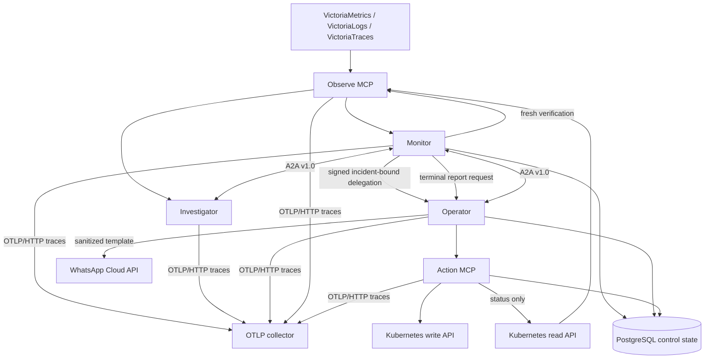

# Architecture

## Purpose

AegisSRE separates incident detection, diagnosis, authorization, and execution so that no reasoning component has ambient infrastructure authority. The system is autonomous inside explicit policy boundaries; it is not autonomous in defining those boundaries.

This document describes the implemented pre-release architecture and its invariants. The executable composes all five services. Deterministic control-plane E2E tests cross real MCP, A2A, and notification HTTP boundaries, and PostgreSQL integration tests exercise concurrent leases, replay recovery, audit insertion, and outbox transitions against a real database. Strict mTLS identity, keyring verification, exact workload policy binding, OTLP trace export, and durable action/report state are implemented. These tests are not a live-k3s acceptance claim; the checked-in laboratory runner has not been executed against the target cluster.

## Context



Every process installs W3C Trace Context and baggage propagation. When a standard `OTEL_EXPORTER_OTLP_*_ENDPOINT` is configured, the binary initializes a bounded batch trace exporter; otherwise it uses a no-op provider. The production overlays configure OTLP/HTTP trace export to the in-cluster collector and restrict egress to that labeled destination. JSON stdout remains the only application-log export path, with `trace_id` and `span_id` added when a valid span is active. Instrumentation must never carry private keys, bearer tokens, raw authorization headers, or unredacted sensitive log content.

## Agent responsibilities

### Monitor

Monitor owns the incident state machine and policy decision, not diagnosis details or Kubernetes writes.

1. Scan immediately at startup and then on the configured interval using bounded, server-owned metric, structured-log, and trace templates.
2. Require the configured number of consecutive qualifying scans for the same rule/namespace/Deployment fingerprint; duplicate rows in one scan count once.
3. Create an incident identifier and ask Investigator for a diagnosis over A2A.
4. Refresh the workload snapshot. Resolve as `resolved_without_action` if it has already recovered; otherwise bind the current resource version and replica count as preconditions.
5. Validate the proposed action and produce a short-lived Ed25519-signed delegation for that exact action.
6. Ask Operator to execute it.
7. After a successful live receipt, take one fresh workload snapshot. Resolve immediately if it is available; otherwise retain the same remediating incident as `verification_pending` and retry only that observation at the start of each scheduled scan.
8. Block redelegation while verification is pending. Resolve the original incident on recovery or escalate it when the `AEGIS_INCIDENT_COOLDOWN` verification window elapses, then suppress the fingerprint for a fresh cooldown. A later recurrence must pass detection verification again and creates a new incident.
9. Send the terminal state back to Operator as a non-authoritative report request. Notification delivery is recorded separately and cannot change recovery state.

Monitor holds the delegation private key. It does not hold a Kubernetes write credential.

Monitor does not expose an external trigger in this revision. Although it publishes an Agent Card and `/a2a` route, its handler rejects inbound workflow requests; only the internal polling loop invokes `Scan`.

### Investigator

Investigator is evidence-driven and read-only.

1. Accept an incident-scoped investigation request over A2A.
2. Select only bounded observe tools.
3. Correlate bounded metrics, structured-log signals, trace signals, workload state, pod history, and events. Missing telemetry degrades the evidence set without expanding the tool budget.
4. Return a structured diagnosis containing evidence references, confidence, alternatives, and a proposed action.

A proposal is advisory. Investigator cannot sign a delegation and cannot call the action plane.

The deterministic heuristic reasoner is the default. When `AEGIS_LLM_BASE_URL`, `AEGIS_LLM_API_KEY`, and `AEGIS_LLM_MODEL` are all configured, an optional Responses API reasoner becomes the primary and the deterministic reasoner is used only if the primary returns an error. A successful but inconclusive provider report is preserved. The provider adapter constrains output with a strict schema, validates evidence citations, and replaces any model-selected target with the trusted target in the investigation request.

### Operator

Operator translates a valid delegation into one typed action request.

1. Require a structured remediation envelope from the authenticated Monitor workload identity; the envelope sender must match that identity.
2. Validate the delegation signature, audience, time window, incident binding, exact parameters, and replay state.
3. Reject anything outside the configured namespace and action allowlists.
4. Call `k8s_execute_remediation` with dry-run preserved.
5. Return a structured receipt.
6. After Monitor declares a resolved, escalated, or failed terminal state, accept a sanitized report request, build a sealed incident report, and invoke the optional WhatsApp notifier idempotently.

Operator has no direct Kubernetes client. The action MCP server repeats authorization before touching the cluster.

Investigator's proposal is the exact task intent, not delegated authority. Monitor remains the sole grant issuer. Report requests contain no grant capability and cannot reach the action MCP path; they use a separate short-lived Ed25519 signature domain so only Monitor can authorize external notification.

## Two MCP privilege planes

The split is a security boundary, not a naming convention.

| Property | Observe MCP | Action MCP |
|---|---|---|
| Purpose | Evidence collection | Exact delegated remediation |
| Callers | Monitor, Investigator | Operator only |
| Kubernetes identity | Read-only | Minimal namespace-scoped write identity |
| Telemetry access | Victoria APIs and bounded pod logs | None; its bounded status tool reads only the exact grant-marked Deployment |
| Delegation required | No | Yes, validated on every action/status request |
| Exact policy | Target and signal-source authorization on every read | Target, action, parameter bounds, and signed policy digest |
| Failure mode | Lose evidence | Lose automation; never fail open |

Deploy the planes as separate workloads and ServiceAccounts in Kubernetes. A single development process may host both for fixture mode, but production credentials must remain separated.

### Observe catalog

The current typed names are:

- `metrics_query_template`
- `logs_query_template`
- `traces_query_template`
- `logs_search`
- `k8s_get_workload_snapshot`
- `k8s_get_pod_logs`

Callers select template identifiers; the server owns PromQL/LogsQL, windows, grouping, timeout, and response caps. In authenticated production mode the same exact workload policy gates the read MCP: namespace scans fan out only to authorized targets/signal sources, and foreign result identities fail closed. Pod-log access proves the current Pod -> ReplicaSet -> Deployment controller chain and both owner UIDs before matching the exact target. Log searches remain constrained by namespace, time window, line count, and result bytes. Kubernetes snapshots are structured summaries rather than arbitrary object retrieval.

### Action catalog

- `k8s_execute_remediation`
- `k8s_get_remediation_result`
- `k8s_get_remediation_status`

An action is a closed domain type, such as restarting or scaling a named Deployment. It is not a free-form verb, resource, patch, or command. `k8s_get_remediation_result` is a non-authorizing exact-fingerprint lookup used to recover a durable receipt after an Operator crash; it does not acquire a lease, refresh a grant, read Kubernetes, or mutate state. The `tools/list` response is authoritative for tools currently available at runtime.

## Clean Architecture

### Domain layer

`internal/core/model` contains value objects and state transitions such as:

- incident identifiers and incident state;
- resource targets;
- evidence items and diagnosis reports;
- remediation actions and preconditions;
- delegation grants and policy decisions;
- action receipts and audit events.

Domain code uses standard-library types only. It does not know A2A, MCP, Kubernetes, Victoria, JSON-RPC, or HTTP.

### Application layer

`internal/app/{monitor,investigator,operator}` orchestrates use cases through ports. It owns sequencing, timeouts, idempotency behavior, and error classification, but not network transport.

### Ports

`internal/core/ports` defines narrow interfaces such as tool calling, peer messaging, reasoning, signing/authorization, clock, ID generation, and audit recording. SDK and infrastructure types do not cross these interfaces.

### Adapters

Outbound adapters implement ports for:

- VictoriaMetrics, VictoriaLogs, and VictoriaTraces;
- Kubernetes read and action clients;
- fixture telemetry and fixture workload state;
- deterministic or model-backed reasoners.
- WhatsApp Cloud API delivery for sealed, sanitized terminal reports.

Fixture mode keeps detection/replay/report state in process memory. With PostgreSQL configured, runtime composition instead uses fenced Monitor leadership/checkpoints, independently scoped Operator and action-MCP execution ledgers, durable receipts and uncertain outcomes, append-only audit records, and atomic incident-report/outbox insertion. Operator and action MCP do not share a replay scope: each must consume and verify its own grant audience.

Inbound adapters under `internal/transport` map A2A and MCP messages to application/domain types. They validate envelopes before invoking a use case and map domain errors to protocol errors.

### Composition

`cmd/aegissre` and platform packages load configuration, construct adapters, and start one requested mode. Composition code is the only place that should know the concrete graph.

```text
transport / adapters ──► application ──► core model
        platform ──────► ports/core

core model ──X──► SDKs, HTTP, Kubernetes, Victoria, environment
```

## Incident lifecycle

```mermaid
sequenceDiagram
    participant VM as Observe MCP
    participant M as Monitor
    participant I as Investigator
    participant O as Operator
    participant AM as Action MCP
    participant K as Kubernetes
    participant W as WhatsApp

    M->>VM: bounded detection query
    VM-->>M: bounded detection samples
    M->>VM: next scheduled detection scan(s)
    VM-->>M: consecutive qualifying samples
    M->>I: A2A investigation task
    I->>VM: metrics/logs/traces/workload evidence
    VM-->>I: bounded results
    I-->>M: diagnosis + proposed action + report digest
    M->>VM: fresh pre-action workload snapshot
    VM-->>M: availability + exact preconditions
    M->>M: resolve without action, or policy-check and sign exact grant
    M->>O: A2A execution task + grant
    O->>O: verify grant and replay state
    O->>AM: execute exact remediation
    AM->>AM: independently verify grant
    AM->>K: dry-run or allowlisted mutation
    K-->>AM: API result
    AM-->>O: action receipt
    O-->>M: structured result
    M->>VM: immediate snapshot after live success
    VM-->>M: healthy, unhealthy, or read error
    alt healthy
        M->>M: resolve original incident
    else unhealthy or read error
        M->>M: retain verification_pending; block redelegation
        loop each scheduled scan until verification window ends
            M->>VM: follow-up workload snapshot
            VM-->>M: healthy, unhealthy, or read error
        end
        M->>M: resolve original incident, or escalate on window expiry
    end
    M->>O: terminal incident.report.request
    O->>O: build sealed sanitized report; deduplicate request ID
    O->>W: approved template (when enabled and egress is allowed)
    O-->>M: report + independent notification receipt
```

Domain envelopes carry incident and correlation IDs across agent hops, while instrumented HTTP transports propagate W3C trace context independently of authorization identity. A receipt records an API outcome, not recovery. After a successful live action, Monitor checks availability immediately. An unhealthy result or read error stores the original remediating incident as `verification_pending`; every scheduled scan checks pending targets before new detection queries, even if the alert fingerprint is no longer emitted. These retries observe only and never resend the mutation. In durable mode, Monitor checkpoints detection, dispatch, pending-verification, report, and cooldown state under a fenced namespace leadership lease so another replica can resume only after takeover. Recovery resolves the same incident. If the cooldown-length verification window elapses without recovery, the incident becomes terminal `escalated`. Dry-run escalates without inferring recovery. WhatsApp failure affects only notification state and never rewrites the incident result.

## A2A v1.0 binding

AegisSRE uses the official A2A data model rather than an internal HTTP protocol exposed under an A2A label.

- Each role publishes an Agent Card, conventionally at `/.well-known/agent-card.json`.
- Supported interfaces advertise protocol version `1.0`.
- Clients send `A2A-Version: 1.0` where required by the selected binding.
- The current adapter uses the official Go SDK's JSON-RPC binding at `/a2a`, requires exactly one structured data part, and refuses an Agent Card that redirects the client to a different origin.
- Incident exchanges use A2A tasks/messages and structured data parts; free-form prose is supplementary, never the authorization contract.
- Task/message IDs and incident IDs are related but distinct. Duplicate delivery of one remediation request preserves its incident and grant IDs; a later Monitor recurrence after cooldown is not a retry and receives a new incident ID.
- In authenticated mode, Agent Cards require mutual TLS. Clients reject cards that omit it, the server verifies TLS 1.3 client certificates before body decoding, and the A2A envelope sender must match the authorized certificate principal.

The pinned `a2a-go` module version is an implementation dependency, not the advertised protocol version.

## MCP 2026-07-28 binding

MCP is served over stateless Streamable HTTP, conventionally at `/mcp`.

- Every request is self-contained; AegisSRE does not depend on `Mcp-Session-Id`.
- Clients identify `2026-07-28` using `MCP-Protocol-Version` and protocol metadata as defined by the specification.
- `Mcp-Method` and, when applicable, `Mcp-Name` must agree with the JSON-RPC body.
- Discovery and list results may be cached only within their declared lifetime/scope.
- Instrumented HTTP clients and servers propagate W3C `traceparent`, `tracestate`, and baggage across MCP requests; trace data is never accepted as caller identity.
- Tool inputs and outputs are typed and validated before reaching an adapter.
- The current server is configured stateless with JSON responses and a 1 MiB request-body limit.

Mutual TLS authenticates each allowed MCP caller in production mode. Stateless means horizontally routable, not replay-safe; replay/execution safety comes from the signed grant and durable scoped execution ledger.

## Data ownership and state

| Data | System of record | Retention expectation |
|---|---|---|
| Raw platform telemetry | Victoria backends / Kubernetes | Controlled by the platform |
| Active Monitor workflow | PostgreSQL fenced checkpoint when configured; memory in fixture mode | Persists confirmation, dispatch, verification, reporting, and cooldown state; it is an operational checkpoint, not a historical incident archive |
| Delegation consumption | PostgreSQL execution ledger, independently keyed by `operator` and `mcp_action` scope | Completed and uncertain records default to 90-day retention; cleanup is an explicit operational task |
| Action receipt | PostgreSQL execution ledger plus A2A response | Exact completed results can be recovered after grant expiry without reopening authorization |
| Audit events | Append-only PostgreSQL table in durable mode; structured JSON in fixture mode | Database grants/retention/export are deployment-owned; runtime roles must not receive update/delete/truncate |
| Incident report / notification | PostgreSQL report and transactional outbox tables when WhatsApp is enabled | Exact request/report dedupe survives restart; delivered-row cleanup and dead-letter operations are explicit |

Raw telemetry should be referenced by query/time range and digest where possible instead of copied indefinitely into incident state.

## Failure semantics

- **Detection query unavailable:** existing pending verifications are attempted first; the detection query then returns an error, the polling loop logs it, and the next scheduled scan tries again. A failed candidate query creates no new incident.
- **Investigator unavailable before a grant:** the current incident outcome becomes `failed`, consecutive confirmation resets, and a later signal must be reverified as a new incident.
- **Monitor crashes before persisting an action dispatch:** a replacement may repeat investigation, but no grant could have been sent before the exact signed remediation envelope was checkpointed. Once checkpointed, only that byte-equivalent envelope is resumed.
- **Operator/action response unavailable after a grant:** durable Monitor mode retries only the checkpointed, byte-equivalent grant envelope. Operator's execution ledger returns an exact stored receipt without repeating the side effect. If action MCP committed first and Operator crashed before its own commit, a replacement takes over only the expired Operator lease and uses `k8s_get_remediation_result` to recover the exact downstream receipt even after grant expiry or policy change. `not_found` can execute only after fresh Operator authorization; if that authorization fails, Operator records `uncertain` because a canceled predecessor may still be accepted after the lookup miss. For `reserved`, Operator re-enters only the exact action endpoint: action MCP atomically rejects a live lease or takes over an expired lease, reconciles the Kubernetes grant marker, and requires fresh action-MCP authorization before any retry-safe mutation. A recovered retry that current authorization or the mutation switch denies becomes `uncertain`, never a no-mutation rejection. Durable leases must exceed the request timeout by more than the ten-second persistence margin; this bounds Aegis-owned overlap but cannot prove the Kubernetes API server will not accept an already-sent canceled request late. A replay/transport error or Operator receipt-commit acknowledgement failure leaves the Operator reservation recoverable; only a durable downstream `uncertain` state or an invalid authenticated receipt makes it uncertain. If the bounded incident window expires without a recoverable receipt, the incident becomes terminal `escalated` with reason `action_outcome_unverified`. An invalid response is rejected and escalated immediately. A `failed` state requires a validated failed or rolled-back receipt.
- **Grant validation disagreement:** reject the action and emit an audit event. Never choose the more permissive result.
- **Duplicate remediation delivery:** an exact completed ledger entry returns its durable receipt, including after signed expiry. A live reservation whose lease expired is reconciled against the exact Kubernetes grant marker/postcondition before takeover; ambiguous results become terminal `uncertain` and are never blindly re-executed. Changed signed content using the same grant or idempotency key fails closed.
- **Notification delivery ambiguity:** report and outbox insertion is atomic, but provider acceptance and the database acknowledgement cannot share a transaction. The worker therefore provides at-least-once delivery: a crash in that window may send the same template twice. Retries use bounded backoff and move to `dead_letter` after the configured attempt limit.
- **Post-action verification not yet healthy:** the original incident remains remediating with status `verification_pending`; each scheduled scan retries the bounded snapshot and blocks redelegation. It resolves on a healthy result or transitions to terminal `escalated` when the cooldown-length verification window expires. No action is retried.

## Target deployment

The checked-in Kubernetes topology is three agent Deployments plus two MCP Deployments, all built from one image and selected by mode/configuration. Kubernetes credentials are mounted only into the matching MCP workload. The manifests include separate ServiceAccounts, namespace Roles, Services, security contexts, and default-deny NetworkPolicies.

The production overlay adds TLS/key/policy/database mounts, a migration Job, collector and PostgreSQL egress, and an intentionally invalid image/target sentinel. The laboratory overlay narrows RBAC and policy to one canary, and its execute child enables the two live mutation gates. This makes the topology reviewable; it does not show that the workloads have been deployed to k3s, that the live Victoria/Kubernetes schemas and permissions work, or that the gated acceptance runner has passed. See [deployment.md](deployment.md).

## Protocol references

- [A2A Protocol v1.0 specification](https://a2a-protocol.org/v1.0.0/specification)
- [MCP 2026-07-28 specification](https://modelcontextprotocol.io/specification/2026-07-28)
- [W3C Trace Context](https://www.w3.org/TR/trace-context/)
